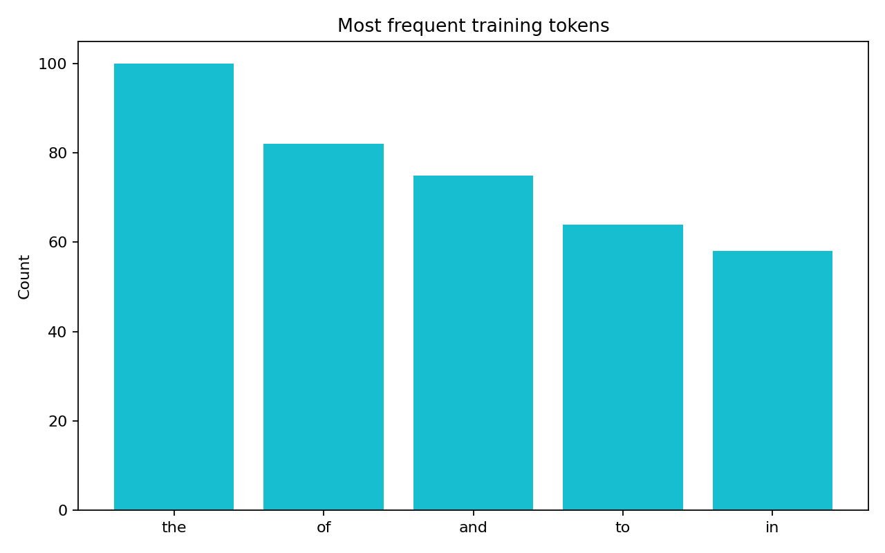
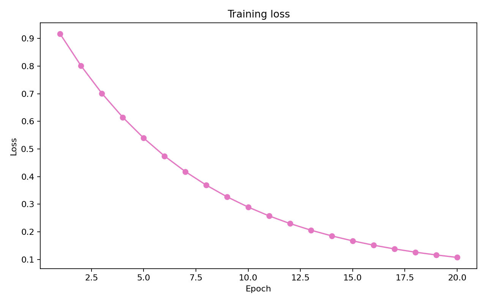

# NLP Text Generator

## Objective

Controlled text generation can accelerate drafting, knowledge-base preparation and analyst prototyping, but it must be measurable and bounded. This project provides a small next-token generation baseline whose training artefacts are easy to inspect, making it a transparent foundation for comparing modelling choices before adopting a larger architecture.

## Architecture

```text
NLP-Text-Generator/
├── assets/
│   └── charts/                         # Token and training diagnostics
├── data/                               # Demonstration corpus inputs
├── notebooks/
│   └── Text Generation Sample using NLP.ipynb
├── src/
│   ├── preprocess.py                   # Tokenisation and vocabulary
│   ├── model.py                        # Next-token baseline
│   ├── generate.py                     # Prompt-based generation
│   └── generate_charts.py              # Training diagnostics
└── tests/
```

## Quickstart

```bash
pip install -r requirements.txt
python -m src.generate_charts
```



Token concentration is a corpus-governance signal: it shows whether generation is supported by diverse language or dominated by recurring boilerplate. That evidence informs corpus curation, vocabulary controls and expectations for generalisation.



The loss curve provides a compact model-development diagnostic, distinguishing useful learning from overfitting and supporting reproducible comparison between training runs. The project is intentionally transparent rather than presented as a production LLM.
